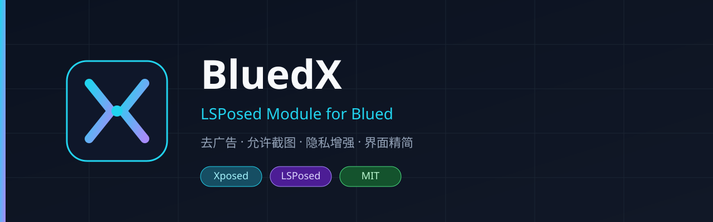

# BluedX



**Blued / 小蓝 体验增强 LSPosed 模块** — 聊天截屏保护 · 去广告 · 允许截图 · 隐私增强

[](../../actions)
[](../../releases)
[](LICENSE)
[](https://github.com/LSPosed/LSPosed)

> 面向 `com.soft.blued` 的开源 LSPosed / Xposed 模块。  
> 只改**你手机上的客户端体验**，不涉及账号破解、付费内容解锁。

---

## 功能

| 功能 | 说明 | 默认 |
|------|------|------|
| **聊天截屏保护** | 强制开启 App 自带隐私开关，私聊防截屏（对双方生效） | 开 |
| **允许截图** | 去掉 `FLAG_SECURE`，聊天 / 直播 / 靓照不再拦截截图录屏 | 开 |
| **拦截广告** | WebView + OkHttp 过滤常见广告域名 | 开 |
| **拦截埋点** | 屏蔽 umeng / bugly / 统计 SDK 请求 | 开 |
| **隐藏已读** | 尽力拦截已读回执（不同版本效果有差异） | 开 |
| **精简信息流** | 隐藏营销横幅 / VIP 引导卡片 | 开 |
| **调试日志** | `logcat -s BluedX` 看 Hook 过程 | 关 |

全部开关可在模块 App 内实时配置，改完强停 Blued 即可生效。

---

## 环境要求

- Android 8.1+（建议 10+）
- **LSPosed**（Zygisk / Riru 版本均可）
- Blued（`com.soft.blued`）

---

## 安装

1. 从 [Releases](../../releases) 下载 `BluedX-x.x.x.apk`  
   仓库根目录也有一份现成的 [`BluedX-1.0.0.apk`](BluedX-1.0.0.apk)  
   或用 Android Studio / `gradle :app:assembleRelease` 自行编译
2. 安装 APK
3. 打开 **LSPosed 管理器** → 模块 → 启用 **BluedX**
4. 勾选作用域：
   - `com.soft.blued` 或 `com.danlan.xiaolan`（小蓝，必须）
   - `top.zixuan.bluedx`（可选，用于设置页显示「模块已激活」）
5. **强行停止 Blued**（或重启手机）
6. 打开 BluedX，按需开关功能

验证是否生效：

```bash
adb logcat -s BluedX
# 应看到 I loading into com.soft.blued 与各 hook installed
```

---

## 项目结构

```
BluedX/
├── app/src/main/java/top/zixuan/bluedx/
│   ├── XposedEntry.java          # Xposed 入口
│   ├── BluedX.java               # 常量
│   ├── hooks/
│   │   ├── SecureFlagHook.java   # 允许截图
│   │   ├── WebViewAdHook.java    # WebView 广告过滤
│   │   ├── HttpAdHook.java       # OkHttp / URL 层过滤
│   │   ├── PrivacyHook.java      # 隐藏已读（尽力而为）
│   │   ├── FeedCleanHook.java    # 精简营销卡片
│   │   └── ModuleStatus.java     # 激活探测
│   ├── util/
│   │   ├── Config.java           # XSharedPreferences
│   │   └── XLog.java
│   └── ui/MainActivity.java      # 开关页
└── .github/workflows/build.yml   # CI 自动出 APK
```

---

## 原理简述

| 模块 | 手段 |
|------|------|
| 聊天截屏保护 | 强制 `is_prohibit_chat_screenshot=1`（App 自带开关）+ 聊天页 `FLAG_SECURE` |
| 截图 | Hook `Window.addFlags / setFlags`，剥离 `FLAG_SECURE`；并处理 `SurfaceView.setSecure` |
| 广告 | Hook `WebViewClient.shouldInterceptRequest` + OkHttp `RealCall`，命中广告域名直接返回空响应 |
| 埋点 | 同上，匹配 umeng / bugly / sensors 等域名 |
| 已读 | 按类名/方法名模式短路发送路径；版本差异大，找不到就静默跳过 |
| 精简 | `Activity.onResume` 后按 view id / tag 模糊匹配营销控件并隐藏 |

所有 Hook 均 `try-catch`，**任何一处失败都不会影响 App 启动**。

---

## 自行编译

```bash
# Android Studio 直接打开本目录，或：
gradle :app:assembleRelease
# 产物：app/build/outputs/apk/release/app-release.apk
```

依赖：JDK 17、Android SDK 34、`de.robv.android.xposed:api:82`（见 `settings.gradle`）。

---

## 适配新版本

Blued 改包名/类名后：

1. 打开模块里的 **调试日志**
2. 强停 Blued，走一遍聊天 / 首页
3. `adb logcat -s BluedX` 看哪条 hook 失败
4. 改 `PrivacyHook` / `FeedCleanHook` 里的候选类名，提 PR

广告 / 截图两条链路不依赖业务类名，一般不用动。

---

## 免责声明

- 本项目仅供 **学习 Xposed / LSPosed 技术** 与个人设备上的体验优化
- 请遵守当地法律法规与 Blued 用户协议
- **不包含**会员破解、付费内容解锁、批量爬取、骚扰或监控功能
- 使用本模块造成的任何后果由使用者自行承担

---

## License

[MIT](LICENSE) © GuiGe101

如果这个模块帮你省了事，欢迎点个 **Star** — 这对我很重要。
